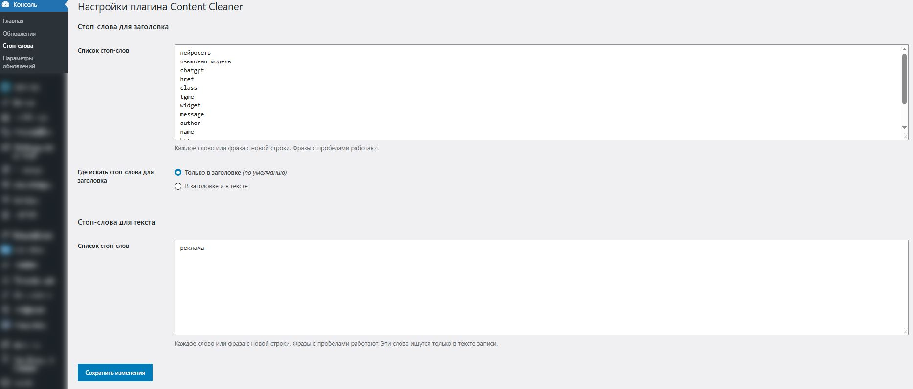

# Content Cleaner (Stopword Drafts)

  

## Автоматическая модерация контента в WordPress

**Content Cleaner** — легкий плагин, который автоматически переводит записи в статус "Черновик", если в их заголовке или тексте обнаружены заданные стоп-слова. Идеально для фильтрации нежелательного контента или AI-генерации.

[Описание](#о-плагине) · [Установка](#установка) · [Использование](#использование) · [Лицензия](#лицензия)

---

 

## О плагине

Плагин перехватывает сохранение записи и проверяет её на наличие стоп-слов. При совпадении запись мгновенно переводится в черновик с добавлением мета-поля, указывающего причину. Также доступна функция массовой ретроспективной проверки всех опубликованных записей с детальным отчетом.

### Возможности:
*   **Раздельные списки стоп-слов**: отдельные настройки для заголовка и текста записи.
*   Гибкая настройка зоны поиска для стоп-слов заголовка: только заголовок или заголовок + текст.
*   Стоп-слова для текста всегда проверяются только в содержимом записи.
*   Поддержка фраз с пробелами в обоих списках.
*   Мгновенная реакция при сохранении записи (`save_post`).
*   Массовая проверка существующих записей с подробным HTML-отчетом.
*   Безопасная архитектура с защитой от CSRF-атак при массовых действиях.

---

## Установка

1. Скачайте ZIP-архив из раздела **Releases**.
2. Перейдите в админке: **Плагины → Добавить новый → Загрузить плагин**.
3. Выберите файл `content-cleaner.zip` и нажмите **Установить**.
4. Активируйте плагин.
5. Перейдите в **Консоль → Стоп-слова** для настройки.

---

## Использование

1. Откройте настройки плагина.
2. В разделе **"Стоп-слова для заголовка"** введите слова, которые должны триггерить проверку заголовка. Выберите зону поиска: только заголовок или заголовок + текст.
3. В разделе **"Стоп-слова для текста"** введите слова, которые должны проверяться только в содержимом записи.
4. Сохраните изменения.
5. Для очистки старого контента используйте кнопку **"Запустить массовую проверку"** внизу страницы настроек.

---

## Лицензия

Copyright © 2026 Elizarov_n906

Этот плагин распространяется под лицензией **GNU General Public License v2 (GPLv2)**.  
Это означает, что вы можете свободно использовать, изменять и распространять плагин при условии сохранения открытости исходного кода.

   
  Разработано — <a href="https://github.com/elizarov-n906">Elizarov_n906</a>

